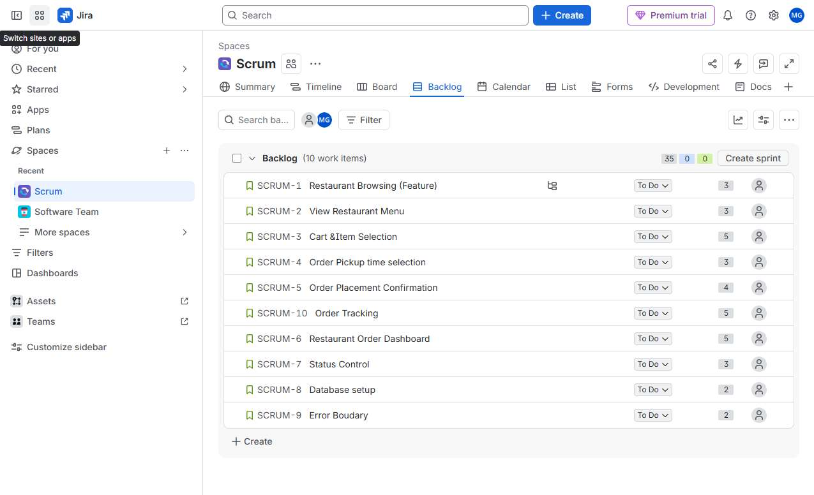
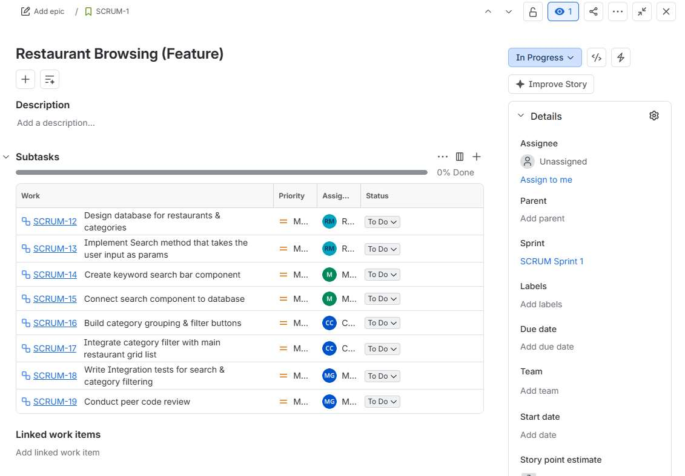
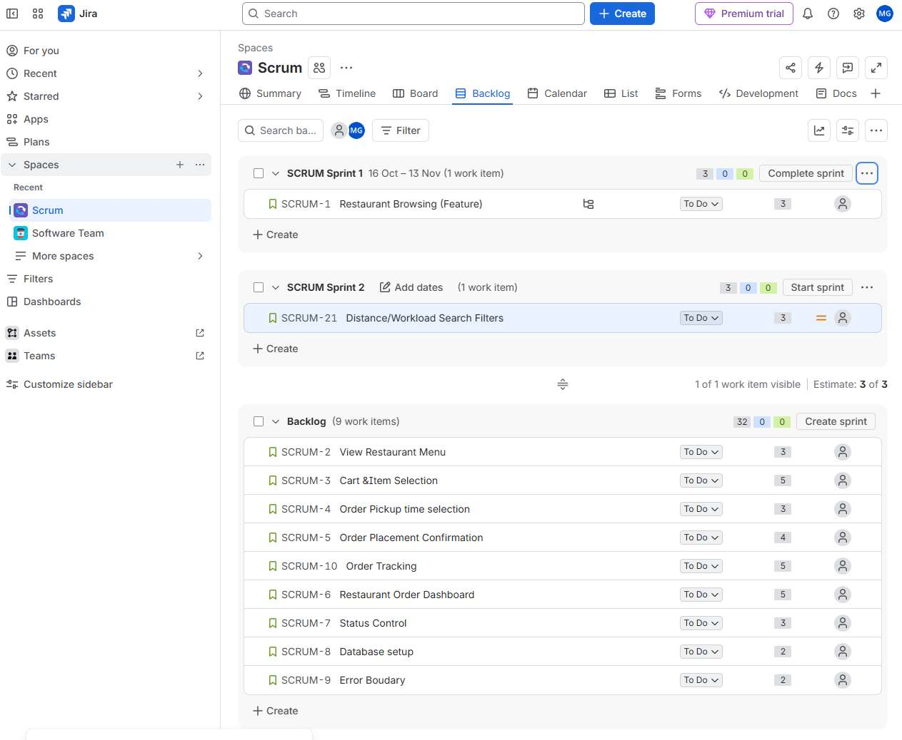
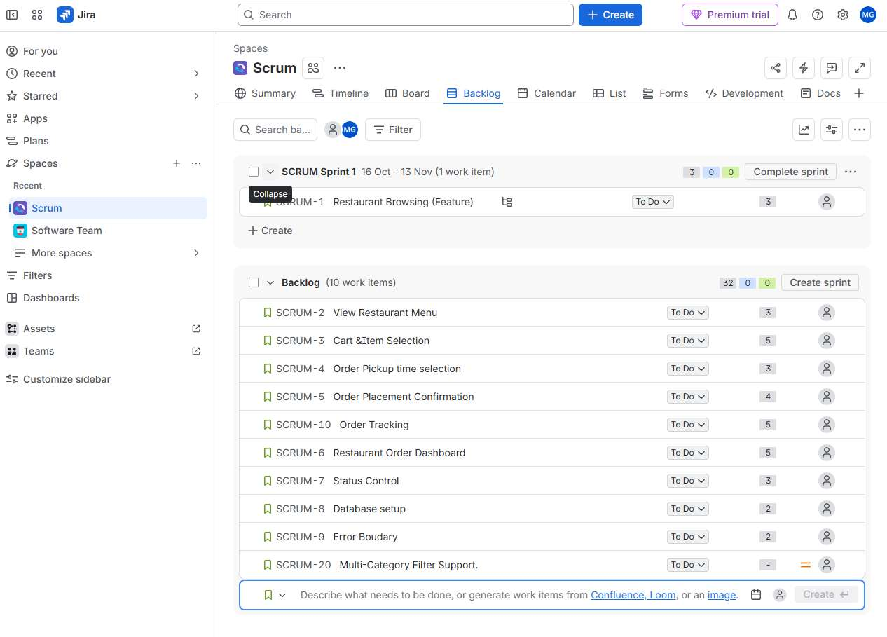

# QuickBite Agile Scrum Documentation

**Group 18:** Michael Daniel Girgis, Matthew Halliburton, Cyril Szekiel Costes, Ricardo Morales Lopez

## Part A: Scrum Team Organization

| Member | Scrum Role | Responsibilities |
|---|---|---|
| Ricardo Morales Lopez | Product Owner / Developer | Database setup |
| Matthew Halliburton | Scrum Master / Developer | Search function |
| Cyril Szekiel Costes | Developer | Category grouping function |
| Michael Girgis | Developer | Testing, code review, and setup documentation |

## Part B: Definition of Done

| Item | Criteria |
|---|---|
| 1. Code Complete | Code complies with standard conventions. |
| 2. Peer Reviewed | PR approved by at least one other developer. |
| 3. Testing | Integration tests written and passed. |
| 4. Acceptance Criteria | Verified by Product Owner against acceptance criteria. |
| 5. Integration | Merged into the main branch without build errors. |

## Part B: Product Backlog

| ID | Title | User Story | Acceptance Criteria | Priority | Estimate |
|---|---|---|---|---|---|
| PBI-01 | Restaurant Browsing | As a Customer, I want to view and search restaurants by keyword or category so I can find where to order. | 1. Displays restaurant card grid. 2. Search bar filters by name. 3. Filter buttons by category. | 1 | 3 SP |
| PBI-02 | Menu Viewing | As a Customer, I want to view a restaurant menu so I can select items. | 1. Grouped by category. 2. Displays name and price. | 2 | 3 SP |
| PBI-03 | Cart Selection | As a Customer, I want to modify my cart so I can prepare an order. | 1. Calculates total price. 2. Local storage persistence. | 3 | 5 SP |
| PBI-04 | Pickup Time Selection | As a Customer, I want to select a pickup time so my food is fresh. | 1. 15-minute time slots. 2. Block past times. | 4 | 3 SP |
| PBI-05 | Order Placement | As a Customer, I want to submit an order with my contact info. | 1. Capture name and phone. 2. Generate Order ID. | 5 | 5 SP |
| PBI-06 | Order Tracking | As a Customer, I want to view order status updates. | 1. Display current status badge. | 6 | 5 SP |
| PBI-07 | Restaurant Dashboard | As a Restaurant Employee, I want to view incoming orders. | 1. List orders chronologically. | 7 | 5 SP |
| PBI-08 | Status Control | As a Restaurant Employee, I want to update order status. | 1. Support state transitions. | 8 | 3 SP |
| PBI-09 | Database Setup | Set up database models and seed data. | 1. Seed script populates restaurants. | 9 | 2 SP |
| PBI-10 | Error Boundary | Handle API failures gracefully. | 1. Toast error on 500 status. | 10 | 2 SP |

*Figure 1. Product Backlog.*

## Part B: Product Owner Priority Rationale

| Rank | PBI | Rationale |
|---|---|---|
| 1 | PBI-01: Restaurant Browsing | Core focus for Sprint 1. Delivers restaurant list, search, and category filter value immediately. |
| 2 | PBI-02: Menu Viewing | Direct next dependency for customer interaction. |
| 3 | PBI-03: Cart Selection | Connects menu selection to order checkout. |
| 4 | PBI-04: Pickup Time Selection | Required for scheduled pickup functionality. |
| 5 | PBI-05: Order Placement | Completes the transaction flow. |

## Part C: Sprint Planning

| Parameter | Details |
|---|---|
| Sprint Goal | Allow a customer to browse, search, and category-filter participating restaurants on the QuickBite platform. |
| Capacity | 4 members x 2 hours/week = 8 hours. |
| Selected Scope | PBI-01: Restaurant Browsing (3 Story Points). |

## Part C: Engineering Tasks

| PBI | Task Description | Assigned | Hours |
|---|---|---|---|
| PBI-01 | TASK-101: Design database for restaurants & categories | Ricardo | 1h |
| PBI-01 | TASK-102: Implement Search method that takes the user input as params | Ricardo | 1h |
| PBI-01 | TASK-103: Create keyword search bar component | Matthew | 1h |
| PBI-01 | TASK-104: Connect search component to database | Matthew | 1h |
| PBI-01 | TASK-105: Build category grouping & filter buttons | Cyril | 1h |
| PBI-01 | TASK-106: Integrate category filter with main restaurant grid list | Cyril | 1h |
| PBI-01 | TASK-107: Write Integration tests for search & category filtering | Michael | 1h |
| PBI-01 | TASK-108: Conduct peer code review | Michael | 1h |

*Figure 2. Sprint Backlog.*

## Part D: Git Commit Log

| Hash | Author | Branch | Commit Message |
|---|---|---|---|
| | Ricardo Morales Lopez | main (PR #4) | Merge PR #4: Database setup and search method. |
| | Matthew Halliburton | feature/restaurant-search | FEAT: Implement keyword search function component |
| | Cyril Szekiel Costes | feature/category-filter | FEAT: Implement category grouping filter component |

## Part D: Working Increment Execution

| Step | Role | System Flow |
|---|---|---|
| 1 | Customer | Navigates to the QuickBite home page. |
| 2 | Customer | Views restaurant list seeded from database set up by Ricardo. |
| 3 | Customer | Types 'Taco' into search bar built by Matthew and new grid with this keyword shows up |
| 4 | Customer | Clicks 'Mexican' category tag built by Cyril and the grid filters by category. |

## Part E: Daily Scrums

| Event | Progress | Impediments | Decisions / Adaptations |
|---|---|---|---|
| Daily Scrum 1 (Day 1) | Ricardo set up database and Matthew built search bar UI draft. | Uncertainty on whether category filtering should be client-side or backend-driven. | Agreed Ricardo provides category fields in the database so that the backend handles the filtering dynamically. |
| Daily Scrum 2 (Day 2) | Search bar connected to the database and Cyril drafted category grouping component. | Cyril is blocked on standardizing category names across backend and frontend. | Ricardo updated the database file with standard category strings (e.g., 'Italian', 'Mexican'). |
| Daily Scrum 3 (Day 3) | Search and category functions fully integrated and Michael completed test execution. | Received mid-sprint change request regarding distance to restaurant based sorting. | Decided to maintain current Sprint Goal; added distance request to Sprint 2 backlog. |

## Part F: Mid-Sprint Change Analysis

| Dimension | Analysis |
|---|---|
| Request | Restaurants want search results to filter by active workload status and max distance. |
| Change | Shift from basic keyword search & category grouping to distance/workload filtering. |
| Questions | 1. Should distance be calculated via GPS or postal code? 2. What defines workload status? |
| New PBIs | PBI-11: Distance/Workload Search Filters (3 SP) |
| Sprint Impact | None. Active Sprint Goal remains focused solely on basic browsing, search, and categories. |
| Action | Added PBI-11 to Product Backlog for evaluation in Sprint 2. |

*Figure 3. Sprint 2 planned to be for Distance/Workload filter.*

## Part G: Sprint Review Feedback

| # | Feedback | Decision | Backlog Action |
|---|---|---|---|
| 1 | Add multi-category selection so users can select 'Mexican' AND 'Fast Food'. | Accept | Added PBI-12: Multi-Category Filter Support. |
| 2 | Show estimated delivery time on the restaurant card. | Reject | Deferred. QuickBite is pickup-only. |
| 3 | Highlight open vs closed status with clearer badge colors. | Accept | Updated PBI-01 acceptance criteria. |

*Figure 4. The backlog with the added PBI-012, Multi-Category Filter Support.*

## Part H: Sprint Retrospective

| Topic | Findings |
|---|---|
| What went well | Aligning member tasks strictly to Database (Ricardo), Search (Matthew), and Categories (Cyril) enabled parallel development. |
| What did not go well | Minor alignment delays on standardizing category name strings between database and client side. |
| What slowed us down | Waiting on database seed structure before client side category buttons could be tested. |
| What helped | Using simple mock test file category responses early. |
| DoD effectiveness | Effective. Peer code reviews by Michael caught search input edge cases. |

## Part H: Improvement Action Items

| # | Type | Action Item | Implementation |
|---|---|---|---|
| 1 | Process | Define app mocks first | Commit static mock test files before writing endpoint logic. |
| 2 | Technical | Debug client side before PR | More commits to debugging before PR creation. |

## Agile Analysis

We demonstrated agility effectively in this small working increment. We delivered small pieces of code each in order to get one work product demonstrating incremental delivery. We also got a sudden change from the product owner mid-project in which they wanted to add a new feature to the app to filter results based on distance and we responded to that change by moving it into the next scrum task showing that we will implement it in the next iteration. The stakeholders provided feedback on our first work product demonstrating stakeholder collaboration. We took the feedback from stakeholders and altered the work product to fit that feedback. We also observed improvements amongst ourselves which we will keep in mind for the next sprint showing continuous improvement with each iteration.

**GenAI Disclosure:** We used Gemini to help brainstorm ideas and suggest a possible scenario for this QuickBites software. We analyzed its response and developed our response to reflect this brainstorming as well as implement our ideas for Part A - Part H.
